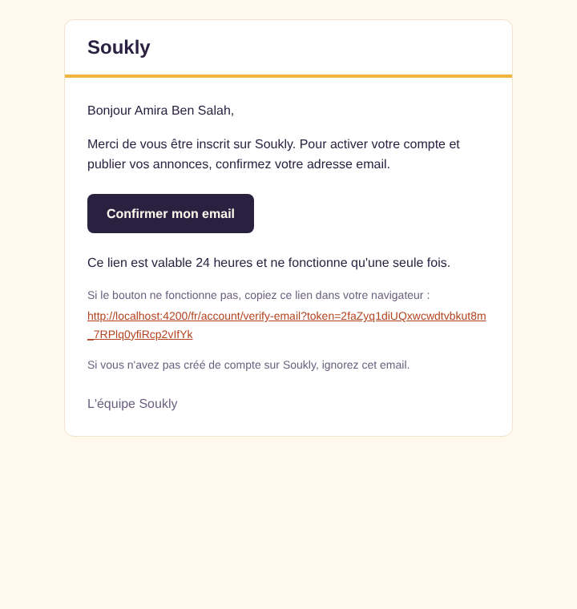
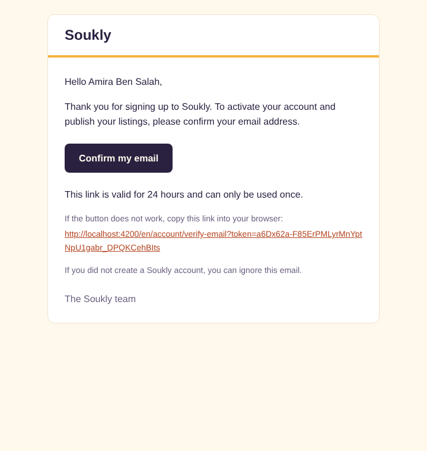
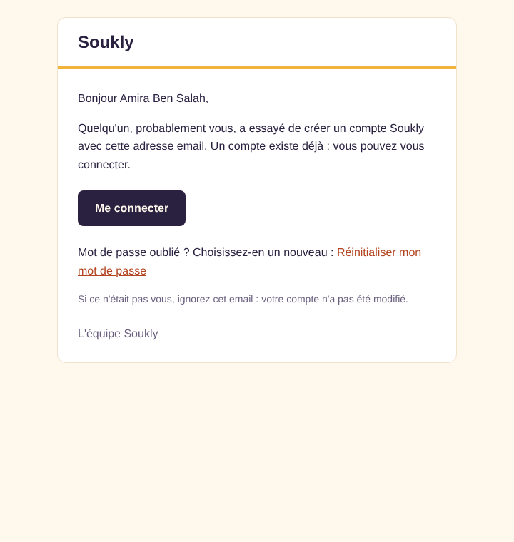
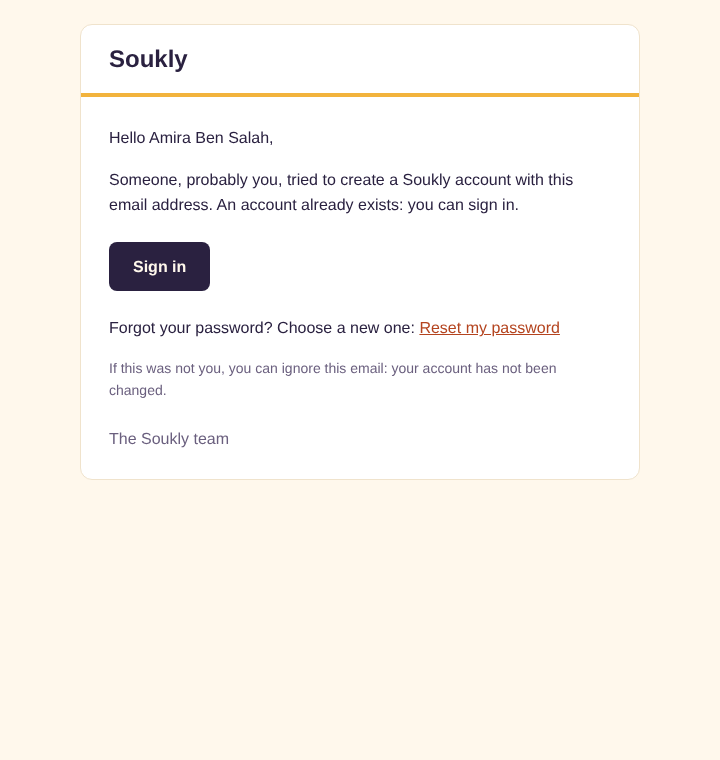

# user-service

Accounts of Soukly: registration and email verification (AUTH-01). Sign-in and JWT arrive with AUTH-02, the
screens with AUTH-03. Port 8081, package `com.soukly.user`, database `soukly_user` (user `user_svc`).

## Endpoints

Exposed by the gateway under `/api` (`POST /api/users/register` reaches this service as `POST /users/register`).

| Endpoint | Body | Answers |
| --- | --- | --- |
| `POST /users/register` | `{ email, password, displayName, phone, acceptTerms }` | `202`, `400` |
| `POST /users/verify-email` | `{ token }` | `204`, `400` |
| `POST /users/verify-email/resend` | `{ email }` | `202`, `400` (malformed email) |

### Registration rules

| Field | Rule | Error codes |
| --- | --- | --- |
| `email` | trimmed and lower-cased, 254 characters at most, `local@domain.tld` | `email.required`, `email.invalid` |
| `password` | 8 to 128 characters, not in the common password list (case ignored), not equal to the email | `password.required`, `password.length`, `password.too-common`, `password.same-as-email` |
| `displayName` | 2 to 50 characters after trimming, shown publicly on listings | `displayName.required`, `displayName.length` |
| `phone` | valid Tunisian number (libphonenumber, region `TN`, mobile or fixed line), with or without `+216`/`00216`, spaces allowed; stored in E.164 (`+21620123456`); not unique, never returned | `phone.required`, `phone.invalid` |
| `acceptTerms` | must be `true`; the acceptance date is stored | `terms.required` |

The preferred language comes from `Accept-Language` (`fr`, `ar`, `en`, French by default), is stored on the account
and used for all its emails.

The answer never reveals whether an email is known: `register` always answers `202` with an empty body, and the
password is hashed in every case so that the response time does not differ.

| Email state | What happens |
| --- | --- |
| new | account `PENDING_VERIFICATION`, verification email |
| `ACTIVE` account | nothing changes, "You already have an account" email (login and forgot-password links) in the account's language |
| `PENDING_VERIFICATION` account | the registration data is replaced by the new one, the older links stop working and a new verification email is sent (counted in the resend limit) |

### Verification and resend

- Token: 32 bytes from `SecureRandom`, Base64 URL; only its SHA-256 is stored. Valid 24 h, single use.
- Link: `{FRONT_BASE_URL}/{lang}/account/verify-email?token=…`.
- `verify-email`: valid token → account `ACTIVE`, `email_verified_at` set, `204`. Unknown, expired or used token →
  `400` with type `urn:soukly:problem:verification-token-invalid` (one answer for the three cases).
- `resend`: always `202`. For a pending account, the older links stop working and a new email is sent, at most 3
  times per hour and per account (registrations of a pending email count too); beyond, nothing is sent.

### Errors

`application/problem+json` built with `com.soukly.common.error.ProblemDetails`. Invalid fields:

```json
{
  "type": "urn:soukly:problem:validation-failed",
  "title": "Validation failed",
  "status": 400,
  "detail": "One or more fields are invalid.",
  "instance": "/users/register",
  "requestId": "6a32b2e8-4d6d-4b39-a79c-af7e8e823d6a",
  "errors": [{ "field": "phone", "code": "phone.invalid" }]
}
```

Each invalid field gets one code, the first rule it breaks. The codes are stable keys translated by the front end.

## Emails

- Sent after the transaction commits (nothing is sent when it fails), on a separate thread. A failed send is logged
  with the user id and the exception type only, and never fails the request: the user can ask for a resend.
- Templates (Thymeleaf, HTML and plain text) in `src/main/resources/mail/`: `verification`, `account-exists` and
  the shared `layout.html`. Texts in `mail/messages_{fr,ar,en}.properties`; Arabic emails have `dir="rtl"`.
- The SMTP health check is disabled: an SMTP outage must not mark the service down.

| fr | ar | en |
| --- | --- | --- |
|  |  |  |
|  |  |  |

## Configuration

| Variable | Local default | Use |
| --- | --- | --- |
| `SPRING_DATASOURCE_URL` | `jdbc:postgresql://localhost:5432/soukly_user` | database |
| `SPRING_DATASOURCE_USERNAME` | `user_svc` | database user |
| `SPRING_DATASOURCE_PASSWORD` | `USER_SVC_DB_PASSWORD` | database password |
| `MAIL_HOST`, `MAIL_PORT` | `localhost`, `1025` (Mailpit) | SMTP server |
| `MAIL_USERNAME`, `MAIL_PASSWORD` | empty | SMTP credentials |
| `MAIL_FROM` | `no-reply@example.com` | sender |
| `FRONT_BASE_URL` | `http://localhost:4200` | origin of the links in the emails |
| `USER_SERVICE_PORT` | `8081` | HTTP port |

## Security notes

- Passwords: Argon2id through Spring Security's `Argon2PasswordEncoder.defaultsForSpringSecurity_v5_8()`, still the
  recommended parameters in Spring Security 7.1 (16-byte salt, 32-byte hash, parallelism 1, 16 MiB, 2 iterations).
  It needs Bouncy Castle (`bcprov-jdk18on`).
- Never logged: passwords, tokens, emails, phone numbers or request bodies; the request records hide their fields
  in `toString`.

## Common password list

`src/main/resources/security/common-passwords.txt` is `Passwords/Common-Credentials/Pwdb_top-10000.txt` from
[SecLists](https://github.com/danielmiessler/SecLists) (MIT licence, Daniel Miessler), commit
`0c03d70db30ceedb941ac58b0ec910eb85906d6f`, unchanged (10,000 entries,
SHA-256 `d9a018818f2357ac34c0534bdfd67826811859ae858bfd6398559085c7f4e925`). The SecLists
`10k-most-common.txt` list was not used because it does not contain `password123`.

## Tests

```bash
cd backend && ./mvnw -pl user-service -am verify    # Docker required (Testcontainers)
```

`RegistrationTests` covers every Gherkin scenario of AUTH-01 against PostgreSQL 18.6 (Testcontainers, same image as
`docker-compose.yml`) and GreenMail, an in-memory SMTP server: no real email service is ever used.
